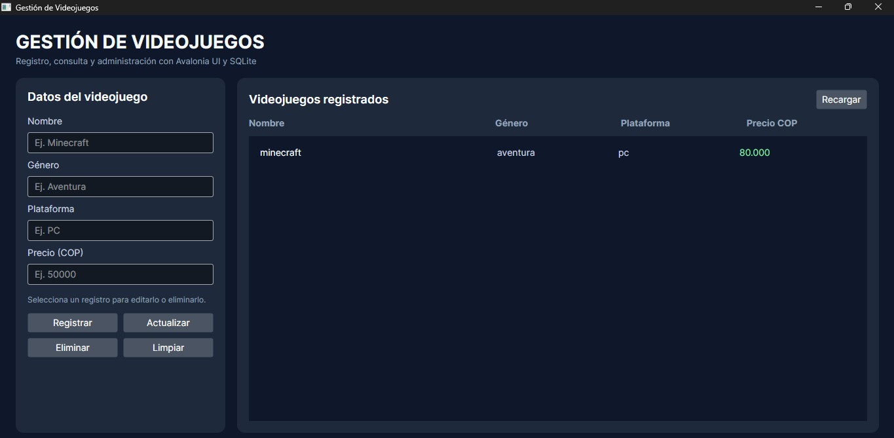
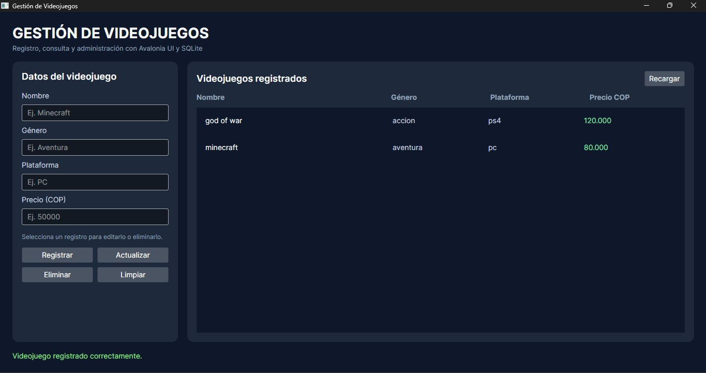
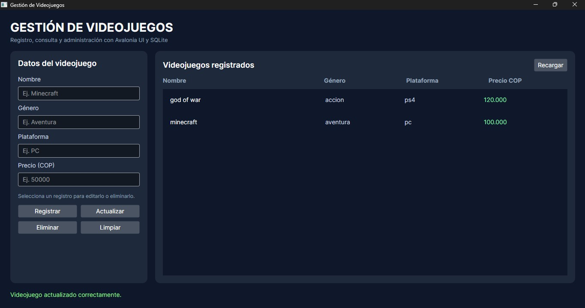
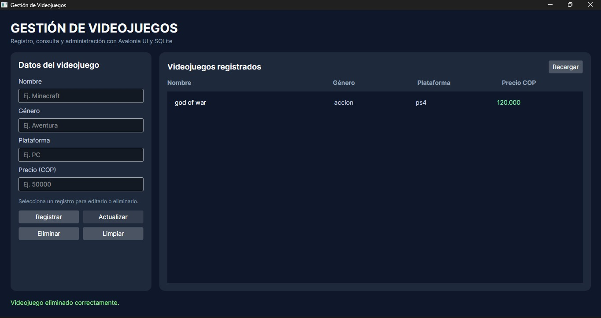
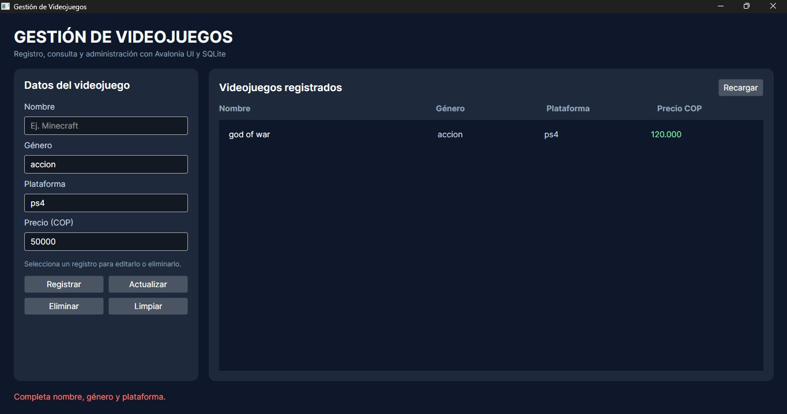
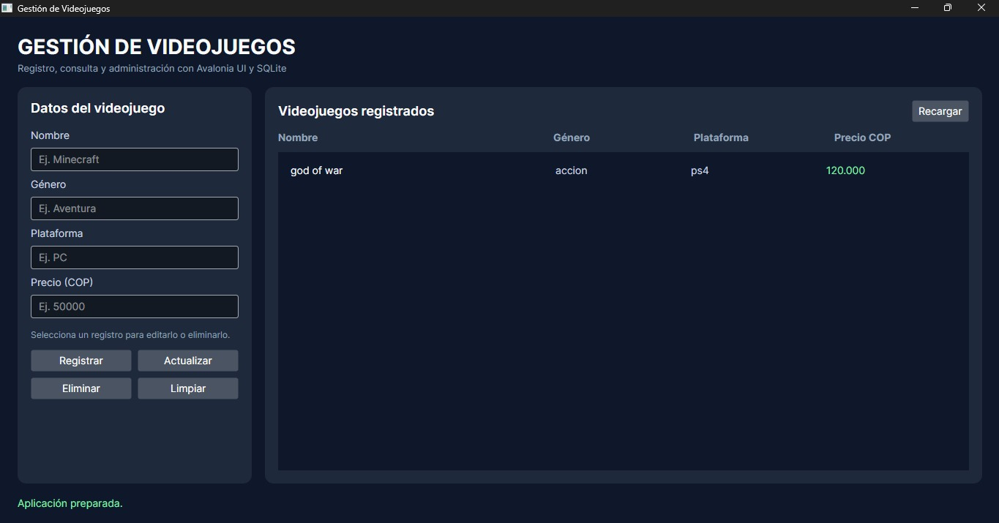

# Gestión de Videojuegos

**Estudiante:** Roberto Viloria Giraldo  
**Asignatura:** Electiva de profundización  
**Proyecto:** Parcial final — Desarrollo de software con .NET

## 1. Información general

Aplicación de escritorio para administrar una colección de videojuegos. Resuelve la necesidad de registrar, consultar, actualizar y eliminar información de videojuegos sin depender de hojas de cálculo ni de comandos SQL manuales. El objetivo es integrar programación orientada a objetos, eventos de una interfaz gráfica y persistencia local.

## 2. Funcionalidades

- **Registrar:** añade nombre, género, plataforma y precio en pesos colombianos.
- **Consultar:** muestra los registros de la base de datos.
- **Actualizar:** selecciona un elemento de la lista, modifica campos y pulsa Actualizar.
- **Eliminar:** selecciona un elemento y pulsa Eliminar (se elimina inmediatamente).
- **Limpiar:** desmarca la selección y vacía el formulario.
- **Recargar:** recupera los registros guardados.
- **Validación:** impide campos obligatorios vacíos, textos demasiado largos y precios inválidos.
- **Persistencia:** conserva los datos al cerrar y volver a abrir la aplicación.

## 3. Tecnologías

- .NET 8 y C# 12
- Avalonia UI (versión declarada en `GestionVideojuegos.csproj`)
- AXAML y eventos de interfaz
- ADO.NET mediante `Microsoft.Data.Sqlite` (versión declarada en `.csproj`)
- SQLite
- Visual Studio Code y Git/GitHub

## 4. Estructura y POO

```text
GestionVideojuegos/
├── Models/Videojuego.cs           # Entidad y constructor
├── Services/VideojuegoServicio.cs # Reglas de negocio y validación
├── Data/VideojuegoDao.cs         # SQL, ADO.NET y conexión SQLite
├── Views/MainWindow.axaml        # Interfaz gráfica
├── Views/MainWindow.axaml.cs     # Manejadores de eventos
├── App.axaml y App.axaml.cs      # Inicio de la aplicación
├── Program.cs                    # Punto de entrada
├── evidencias/                   # Capturas de pruebas funcionales
└── GestionVideojuegos.csproj     # Dependencias
```

La clase `Videojuego` encapsula los atributos de cada registro con propiedades y un constructor; `VideojuegoServicio` aplica las validaciones y recibe un objeto DAO mediante su constructor; `VideojuegoDao` concentra el acceso a datos. La ventana realiza la interacción y llama al servicio. La separación evita colocar toda la lógica en un único archivo.

## 5. Instalación

1. Instalar el **SDK .NET 8**.
2. Clonar el repositorio: `git clone https://github.com/roberto-viloria/-GestionVideojuegos.git`.
3. Entrar en la carpeta que contiene `GestionVideojuegos.csproj`.
4. Restaurar dependencias con `dotnet restore`.
5. Compilar con `dotnet build`.

Se necesita un entorno de escritorio compatible con Avalonia UI. La primera restauración de paquetes requiere internet.

## 6. Ejecución

Desde la carpeta del archivo `.csproj`:

```powershell
dotnet restore
dotnet run
```

No se requieren credenciales ni un servidor SQLite externo.

## 7. Base de datos

Se crea automáticamente `videojuegos.db` en `%LOCALAPPDATA%\GestionVideojuegos\` (Windows), usando `Environment.SpecialFolder.LocalApplicationData` en C#. Tabla `Videojuegos`: `Id` (entero autoincremental, clave primaria), `Nombre`, `Genero`, `Plataforma` (texto obligatorio) y `Precio` (entero no negativo). El archivo persiste al cerrar la aplicación. `Data/VideojuegoDao.cs` usa conexiones ADO.NET y comandos SQL `CREATE TABLE`, `SELECT`, `INSERT`, `UPDATE` y `DELETE` con parámetros para los valores introducidos por el usuario. `using` libera conexiones, comandos y lectores.

**Nota:** La base de datos no se sube necesariamente a GitHub: la aplicación puede crear una vacía al arrancar. La información personal almacenada localmente queda fuera del repositorio.

## 8. Pruebas funcionales y evidencias

Se realizaron seis pruebas funcionales para comprobar el comportamiento de la aplicación.

### 8.1. Registro
Se registró un videojuego mediante el formulario. El sistema mostró el registro en la lista.



### 8.2. Consulta
Se consultaron los videojuegos almacenados y se verificó su visualización en la interfaz.



### 8.3. Actualización
Se seleccionó un videojuego, se modificó su precio y se verificó el cambio.



### 8.4. Eliminación
Se eliminó un videojuego seleccionado y se comprobó que desapareciera de la lista.



### 8.5. Validación
Se intentó registrar información incompleta. El programa mostró un mensaje de error sin cerrarse.



### 8.6. Persistencia
Se cerró y volvió a ejecutar la aplicación. Los registros almacenados permanecieron disponibles.



## 9. Problemas encontrados y soluciones

### Incompatibilidad de Microsoft.Data.Sqlite

Durante la instalación se presentó el error NU1202 porque la versión 11.0.0 del paquete Microsoft.Data.Sqlite requería .NET 10 y el proyecto utilizaba .NET 8.

Se solucionó instalando una versión compatible mediante:

`dotnet add package Microsoft.Data.Sqlite --version 8.0.0`

Posteriormente se ejecutaron `dotnet restore` y `dotnet build`.

### Error de propiedades en Avalonia UI

Durante la compilación aparecieron errores AVLN2000 relacionados con las propiedades Nombre, Genero, Plataforma y PrecioVisible de la plantilla de datos.

Se corrigió la declaración del tipo de datos en el archivo MainWindow.axaml mediante `x:DataType`, identificando la clase Videojuego del espacio de nombres Models.

Después de la corrección, el proyecto compiló correctamente con cero errores y cero advertencias.

## 10. Repositorio del proyecto

https://github.com/roberto-viloria/-GestionVideojuegos
